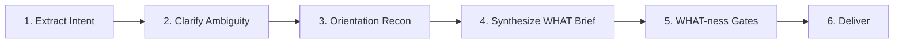

# create-prompt

Turns the user's unstructured thoughts into a structured, self-contained **statement of the problem
and the desired outcome** — explicitly *not* a solution.

This skill sits at stage two of this pipeline:

```text
user's raw thoughts → [create-prompt] → WHAT brief → planning agent → HOW plan
    → plan review → implementing agent → implementation review
```

Everything downstream decides *how*. This skill decides *what* and *why*, and makes both
unambiguous, verifiable, and grounded in real repository vocabulary.

This is a **personal** skill: it lives in `~/Pets/skills/prompting/create-prompt` and runs across
worktrees and repositories without ever committing to project codebases.

When users ask an agent to "prepare a prompt for another agent", agents commonly make these errors:

1. They start **implementing the task** or running builds/tests in the current session.
2. They enter a multi-step **plan mode** to plan their own execution instead of producing the prompt.
3. They **prescribe the solution** — file-by-file edits, step-by-step logic, function signatures —
   stealing the planner's job and locking in a design nobody reviewed.
4. They **silently invent** answers to things the user never specified, instead of asking or
   surfacing them as open questions.

`create-prompt` enforces a strict separation: **capture intent, clarify ambiguity, orient with
read-only recon, and deliver a WHAT-only brief.**

Companion references alongside this file:

- [`reference/templates.md`](reference/templates.md) — the primary WHAT template plus feature,
  bugfix, and refactor variants.
- [`reference/checklist.md`](reference/checklist.md) — WHAT-ness quality gates to run before
  delivering the prompt.

---

## Hard Rules

1. **No solution prescription.**
   The prompt states the problem and the desired outcome. It must not contain step-by-step logic,
   function or class signatures to add, "modify file X so that it does Y", chosen algorithms,
   chosen data structures, or build/test commands to run. If the user genuinely mandates a solution
   detail, it goes under `Constraints`, labelled as a constraint the planner must respect — never
   presented as a design.
   *Litmus test:* two competent engineers should be able to read the brief, pick **different**
   designs, and both fully satisfy it.
2. **Never implement the underlying task in the current session.**
   All repository interaction stays strictly **read-only**: searching, reading, inspecting history.
   No edits to source, tests, or configuration.
3. **Never enter task-execution planning mode for yourself.**
   No delivery plans or execution checklists for the requested feature. You are the intent
   clarifier and brief author, not the planner and not the implementer.
4. **Ask, or surface — never invent.**
   Where the user's thoughts are ambiguous, either ask a small number of focused questions (prefer
   this when the answer changes the shape of the work) or record the gap under
   `Open Questions for the Planner`. Never fill a gap with a guess presented as a requirement.
5. **Ground names, not solutions.**
   Every subsystem, module, symbol, and path named in the brief must exist and be verified. Recon
   grounds the *vocabulary* and *orientation*; it does not choose the implementation.
6. **Keep it short.**
   Target ~40–80 lines. Volume is the main force that drags a brief into HOW. If a section has
   nothing real to say, omit it.
7. **Clean, uncluttered delivery.**
   Output only the brief — written to a file if requested, otherwise a single markdown code block.
   No "Sure, here is your prompt:", no recap of your research steps.

---

## Workflow



### Step 1 — Extract Intent

From the user's unstructured input, separate:

- **Problem / motivation** — what is wrong or missing today, and why it matters.
- **Desired outcome** — what should be observably true once this is done.
- **Hard constraints** — things that must hold (compatibility, severity, platform, deadlines,
  a mandated technology).
- **Preferences** — the user's loose opinions, explicitly marked as non-binding.
- **Solution fragments the user already voiced** — do not promote these to requirements. Either
  record them as constraints (if the user means them as mandates) or as preferences.
- **Scope boundaries and non-goals** — what this work is *not*.

### Step 2 — Clarify Ambiguity

List what is genuinely undetermined. For each gap, decide:

- **Ask the user now** — when the answer changes the shape of the work (which users are affected,
  is this a fix or a redesign, must old behaviour keep working). Keep it to a handful of focused
  questions.
- **Defer to the planner** — when it is a legitimate design decision. It goes into
  `Open Questions for the Planner`.

Also flag **false premises**: if the user's description contradicts what the repository actually
does, say so plainly rather than encoding the mistake into the brief.

### Step 3 — Orientation Recon (read-only)

Recon exists to orient the planner, not to design for them. Gather only:

1. **Where this lives** — the subsystem, module, or component that owns the behaviour, and its
   entry points.
2. **Vocabulary check** — confirm the user's terms map to real symbols and concepts; correct them
   if they do not.
3. **Current behaviour** — what the code actually does today, stated factually.
4. **Reference material** — existing analogous features worth reading, offered as *context only*,
   never as "follow this pattern".
5. **Verifiability surface** — which test suites or observable behaviours would demonstrate the
   outcome. Name them; do not map expected breakages or plan suppressions.

Stop when the planner could find their way. Do not chase exact signatures, helper methods, or
positioning strategies — that is solution-space research and belongs to the planner.

### Step 4 — Synthesize the WHAT Brief

Use this structure (see [`reference/templates.md`](reference/templates.md) for filled variants):

```markdown
<One-sentence goal, stated as an outcome>

### Background / Current Behaviour
What the system does today and why that is a problem. Factual, verified.

### Desired Outcome
What should be true when this is done. Outcomes, not steps.

### Acceptance Criteria
- Given <situation>, <observable result>.
- (Each one observable and verifiable by someone who did not write the code.)

### Scope & Non-Goals
- In scope: <boundary>
- Out of scope: <explicitly excluded>

### Constraints
- Hard: <must hold — including any solution detail the user genuinely mandates>
- Preference (non-binding): <user's opinion>

### Open Questions for the Planner
- <Decision deliberately left to planning.>

### Orientation
- `<path or subsystem>` — why it is relevant.
- Related prior art (reference only, not a prescription): `<path>`.
```

Omit empty sections. Do not add sections describing implementation steps.

### Step 5 — WHAT-ness Gates

Run the brief against [`reference/checklist.md`](reference/checklist.md). The rejecting gates:

- [ ] Does the brief state *how* to implement anything? → reject and rewrite.
- [ ] Could two competent engineers pick different designs and both satisfy it? → must be **yes**.
- [ ] Is every acceptance criterion observable and verifiable?
- [ ] Are unknowns surfaced as open questions rather than guessed?
- [ ] Is every named path, symbol, and subsystem verified to exist?
- [ ] Is it self-contained for a reader with zero knowledge of this conversation?
- [ ] Is it within ~40–80 lines, with no filler or meta-commentary?

### Step 6 — Deliver

- **If a file was requested or implied (e.g., `prompt.md`):** write the brief there using
  repository-relative paths, then give a one-line confirmation naming the file.
- **If outputting to chat:** emit the brief inside a single ` ```markdown ` block, nothing else.
- **If you chose to ask clarifying questions in Step 2:** ask them first, in a short list, before
  producing the brief.
